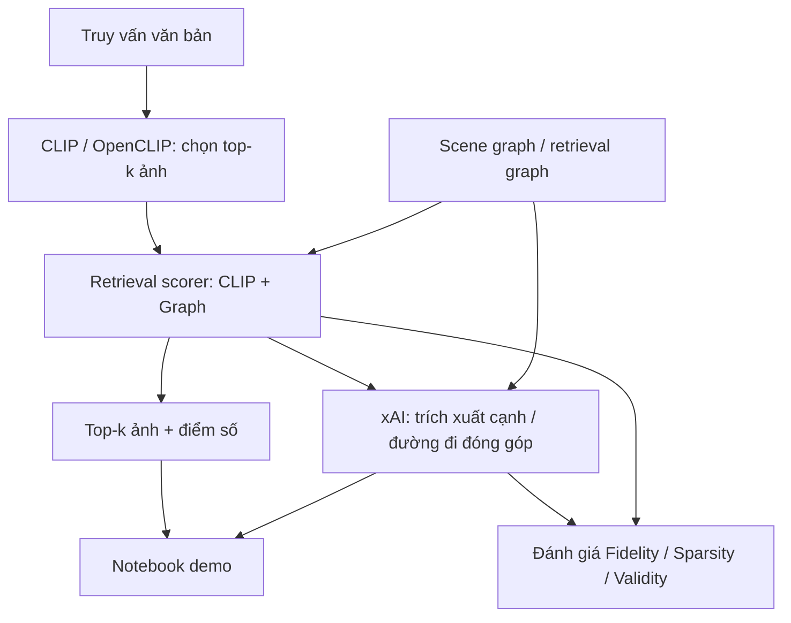

# Nhiệm vụ 3 — Explainability (xAI) cho Text-to-Image Retrieval

> **Bài toán:** Knowledge Graph–Enhanced Text-to-Image Retrieval
> **Mục đích tài liệu:** Mô tả phạm vi nhiệm vụ, kiến trúc tích hợp, tổ chức mã nguồn, đầu vào/đầu ra và tiêu chí nghiệm thu.
> **Kế hoạch chi tiết:** [`01_XAI_Explainability_Plan.md`](./01_XAI_Explainability_Plan.md).

## 1. Tổng quan nhiệm vụ

Mục tiêu là giải thích vì sao một ảnh được xếp hạng cao bằng **cạnh, đường đi hoặc đồ thị con thực sự ảnh hưởng đến graph score/final score**, sau đó đánh giá định lượng **fidelity, sparsity và validity**.

**Nguyên tắc xuyên suốt:** Không tạo lời giải thích chỉ vì đường đi nghe có vẻ hợp lý. Explanation phải xuất phát từ đúng đồ thị, scorer và cơ chế xếp hạng đang sử dụng; có thể kiểm chứng bằng can thiệp lên cạnh/đường đi và chạy lại mô hình.

### 1.1. Phạm vi tối thiểu

| Thành phần | Phạm vi cần thực hiện | Đầu ra chính |
|---|---|---|
| xAI extractor | Trích xuất các cạnh/đường đi có đóng góp cho từng `(query, image)` | Edge/path list, contribution, graph con |
| xAI evaluation | Fidelity, sparsity, structural validity, evidence support; baseline xóa cạnh ngẫu nhiên | Bảng metric và phân tích trường hợp |
| Truy vấn đánh giá | Tối thiểu 10 truy vấn phân tích định lượng; ưu tiên dùng bộ ≥20 truy vấn trực tiếp/gián tiếp của nhóm | `queries.csv`, case studies |
| Demo | Nhập truy vấn → hiển thị top-k ảnh → giải thích → kiểm tra thay đổi score/rank | Notebook chạy lại được |

## 2. Kiến trúc tổng thể



Module xAI nhận graph, danh sách ảnh ứng viên và scorer; tạo explanation, can thiệp lên graph rồi đo ảnh hưởng đến score/rank. Điểm tích hợp với pipeline của nhóm là `image_id`, `query_id`, graph schema, scorer interface, split/seed và các bảng kết quả được thống nhất.

## 3. Cấu trúc thư mục mã nguồn đề xuất

Đây là **cấu trúc cần tạo khi bắt đầu triển khai**, không phải tuyên bố các module Python đã được viết sẵn.

```text
task3/
├── README.md                         # Nội dung tổng quan (tài liệu này)
├── 01_XAI_Explainability_Plan.md      # Checklist triển khai xAI
├── requirements.txt                   # Các thư viện cần thiết
├── .gitignore                         # Bỏ qua cache, model weights, ảnh lớn
│
├── configs/
│   ├── config.yaml                    # Đường dẫn dữ liệu, seed, alpha, top-k...
│   ├── graph_schema.json              # Node types, relation types, ràng buộc cạnh
│   └── relation_vocab.json            # Danh sách quan hệ và mapping chuẩn hóa
│
├── xai/
│   ├── __init__.py
│   ├── scorer_adapter.py              # Interface score(); mock scorer và model thật
│   ├── explain.py                     # Trích top edges / paths theo đóng góp
│   ├── perturbation.py                # Mask/remove edges và chạy lại scoring
│   ├── evaluate_xai.py                # Fidelity, sparsity, validity, random baseline
│   ├── visualize.py                   # Vẽ explanation graph, score/rank trước-sau
│   └── queries.csv                    # Bộ truy vấn đánh giá và ground truth
│
├── integration/
│   ├── graph_io.py                    # Đọc/ghi graph từ dữ liệu nhóm
│   └── retrieval_adapter.py           # Kết nối CLIP / GNN / reranker của nhóm
│
├── experiments/
│   ├── xai_results.csv                # Metric theo query/image/seed/k
│   ├── figures/                       # Biểu đồ phân tích
│   └── case_studies/                  # 5 success + 5 failure, evidence liên quan
│
├── notebooks/
│   └── demo_task3.ipynb               # Truy vấn → top-k → giải thích → perturbation
│
└── tests/
    ├── test_scorer_adapter.py
    └── test_xai_metrics.py
```

**Lưu ý tổ chức repo:** Nếu nhóm có repo chung, có thể đặt toàn bộ cấu trúc trên dưới `task3/` hoặc `src/task3/`. Không cần sao chép mô hình CLIP/GNN và dataset lớn vào đây: sử dụng checkpoint/path và adapter trỏ sang artifact chung. Các tệp `.csv` trong sơ đồ là **đầu ra dự kiến**, không bắt buộc commit ảnh hoặc dữ liệu có hạn chế phân phối.

## 4. Các module cần thực hiện

### 4.1. Module xAI

- **`scorer_adapter.py`:** Thống nhất API tính `clip_score`, `graph_score`, `final_score`. Hỗ trợ scorer mẫu để kiểm thử và adapter cho scorer GNN/reranker thật của nhóm.
- **`explain.py`:** Xác định đồ thị con ảnh hưởng tới dự đoán, đo đóng góp từng cạnh/đường đi và chọn explanation ngắn gọn.
- **`perturbation.py`:** Thực hiện xóa/mask cạnh explanation hoặc cạnh ngẫu nhiên; **tính lại graph-dependent score** trên graph sau can thiệp.
- **`evaluate_xai.py`:** Đo giảm score, đổi hạng, sparsity, validity và so sánh với random baseline.
- **`visualize.py`:** Hiển thị graph/path và các giá trị giải thích được trong notebook.

Các metric cốt lõi:

| Metric | Ý nghĩa | Phép kiểm tra |
|---|---|---|
| Fidelity | Cạnh giải thích có ảnh hưởng thật đến dự đoán? | Xóa cạnh explanation, tính lại score/rank; đối chiếu xóa cạnh ngẫu nhiên cùng số lượng |
| Sparsity | Giải thích có cô đọng? | `1 - #explained_edges / #local_candidate_edges` |
| Structural validity | Quan hệ/đường đi có hợp lệ trong graph? | Kiểm tra edge IDs, node types, relation schema và tính liên thông |
| Evidence support | Giải thích có căn cứ từ dữ liệu nguồn? | Kiểm tra metadata/caption/triple provenance; rà soát mẫu |

Fidelity cần báo riêng biến động **graph score** và **final score**. Các so sánh thứ hạng phải sử dụng cùng candidate pool, cùng mô hình và cùng tham số.

## 5. Tích hợp với pipeline của nhóm

Các thành phần bên ngoài nhiệm vụ 3 được coi là **dependencies**, không phải phần cần triển khai lại:

| Đầu vào cần nhận | Nguồn từ nhóm | Yêu cầu tích hợp |
|---|---|---|
| CLIP features/scores, `candidate_image_ids`, split | Nhánh baseline retrieval | IDs cố định; score truy cập được cho mọi ứng viên |
| Graph schema, graph builder, GNN checkpoint/forward | Nhánh graph-enhanced retrieval | Có thể chạy lại forward khi thay đổi cạnh |
| Reranker tốt nhất, bộ truy vấn direct/indirect | Nhánh phương pháp mới | Cùng input/output và cùng evaluation protocol |

Đề xuất interface logic:

```python
# Pseudocode/API contract — các hàm sẽ được triển khai trong repo.
scores = scorer.score(query_text, candidate_image_ids, graph)
# scores[image_id] = {"clip_score": ..., "graph_score": ..., "final_score": ...}

explanation = explainer.explain(query_text, image_id, graph, scorer)
# explanation = {"edge_ids": [...], "paths": [...], "contributions": {...}}

metrics = evaluator.evaluate(
    query_text, image_id, candidate_image_ids, graph,
    scorer, explanation
)
# metrics = {"fidelity": ..., "sparsity": ..., "structural_validity": ...,
#            "evidence_support": ..., "rank_drop": ...}
```

Khi thành phần upstream chưa sẵn sàng, dùng graph/scorer mẫu **chỉ để phát triển và kiểm thử**. Thí nghiệm cuối phải dùng đúng scorer/model retrieval thực tế của nhóm.

## 6. Quy trình thực thi ở mức module

1. **Chuẩn hóa cấu hình và schema:** Thống nhất ID, node/relation types, score interface, dữ liệu/split và cơ chế lưu provenance.
2. **Xây xAI độc lập:** Dùng scorer mẫu để kiểm thử contribution, edge removal, random deletion, metric và biểu đồ.
3. **Tích hợp retrieval:** Kết nối adapter tới CLIP/GNN/reranker của nhóm, bảo đảm xóa cạnh dẫn tới chạy lại graph scoring.
4. **Đánh giá xAI:** Chạy trên tập truy vấn cố định, so sánh explanation vs random và phân tích 5 trường hợp thành công/5 thất bại.
5. **Đóng gói demo và tài liệu:** Xuất CSV, hình biểu đồ, notebook, hướng dẫn chạy và hạn chế của kết quả.

## 7. Tiêu chí nghiệm thu

- [ ] Có xAI extractor gắn với **cơ chế score thật**, không chỉ tạo đường đi hậu kiểm.
- [ ] Có fidelity, sparsity, validity và phép thử explanation-vs-random trên **ít nhất 10 truy vấn**.
- [ ] Có phân tích **5 retrieval success + 5 retrieval failure** và notebook hiển thị explanation.
- [ ] Có split/seed cố định, không dùng test để tuning hoặc tạo cạnh thống kê, và các thí nghiệm chính có thể chạy lại.
- [ ] Có hướng dẫn cài dependencies và các entry point chạy; không cần dựng web app hoàn chỉnh.

## 8. Ranh giới phạm vi và nguyên tắc thực hiện

- Không huấn luyện lại encoder thị giác lớn từ đầu; tận dụng mô hình của nhóm hoặc pretrained encoder.
- Không mở rộng nhiều phương pháp explainer/graph database nếu chưa hoàn thành pipeline định lượng tối thiểu.
- Không lấy nhãn relevance hoặc chọn hyperparameter từ chính tập test.
- Không nhầm **tính hợp lệ của cạnh** với **mức ảnh hưởng thực tế của cạnh lên quyết định xếp hạng**.
- Ưu tiên mã có thể kiểm thử, kết quả tái lập, nguồn dữ liệu minh bạch và demo ngắn gọn.

## 9. Implementation xAI hiện có

Phần xAI đã được cài đặt trong `xai/` và chạy độc lập. Core không phụ thuộc thư viện ngoài; `matplotlib` và `networkx` chỉ cần khi xuất hình.

### Cài đặt và chạy nhanh

Yêu cầu Python 3.10 trở lên.

```bash
cd duong
python -m pip install -e '.[dev,viz]'
python -m pytest -q
python -m mmxai.xai.cli --output-dir experiments/demo --top-k 2 --seed 0
```

Nếu chỉ muốn chạy test core mà chưa cài pytest: `python -m unittest discover -s tests -v`.

Lệnh demo dùng graph/scorer mẫu có thể kiểm toán và ghi `explanation.json`, `xai_results.csv`. Đây chỉ là smoke test, không phải kết quả thực nghiệm của scorer GNN thật.

### Module

| Module | Vai trò |
|---|---|
| `xai/graph.py` | Node/edge ID ổn định, provenance, evidence status, schema và graph bất biến khi perturb |
| `xai/scorer_adapter.py` | `Scorer` protocol, callback adapter cho model thật, mock path scorer |
| `xai/explain.py` | Leave-one-edge-out, đóng góp graph/final score, chỉ tạo path khi cạnh thật sự nối nhau |
| `xai/perturbation.py` | Delete/retain edge, score lại toàn candidate pool, rank ổn định |
| `xai/evaluate_xai.py` | Fidelity, rank drop, random baseline, sparsity, structural/path validity, evidence support |
| `xai/experiment.py` | Ma trận `k={1,3,5}`, nhiều seed, direct/indirect và chọn case success/failure |
| `xai/io.py` | Đọc graph/schema JSON, ghi explanation JSON và results CSV |
| `xai/visualize.py` | Tóm tắt text và vẽ explanation graph tùy chọn |

`Scorer.score()` phải nhận toàn bộ candidate pool và trả đủ ba score cho mỗi ảnh:

```python
from mmxai.xai import CallableScorerAdapter, ScoreComponents

def score_fn(query, candidate_ids, perturbed_graph):
    # 1. Chuyển perturbed_graph thành edge_index/edge_type.
    # 2. Chạy LẠI model/QAData và graph score trên graph này.
    # 3. Chuẩn hóa/fuse trên đúng candidate_ids như retrieval gốc.
    return {
        image_id: ScoreComponents(clip[image_id], graph_score[image_id], final[image_id])
        for image_id in candidate_ids
    }

def local_edges_fn(query, image_id, graph):
    # Trả đúng các cạnh trong receptive field/path mà scorer có thể sử dụng.
    return edge_ids_in_model_receptive_field(query, image_id, graph)

scorer = CallableScorerAdapter(score_fn, local_edges_fn)
```

Với QA scorer hiện tại của nhóm, `contains` có hướng `concept → image`; các cạnh `sg_rel`/`concept` nối concept với concept. Khi adapter nhận graph đã xóa cạnh, cần dựng lại tensor `edge_index`, danh sách label của ảnh và chạy lại `label_h`/`concept_image_match`. Không được tái sử dụng graph embedding đã cache từ full graph.

### Chạy thí nghiệm chính

- Dùng `xai/queries.csv` làm catalog; relevance vẫn lấy từ `khanh/queries/eval_queries.json`, không suy ra từ model.
- Dùng `run_matrix(...)` với candidate pool cố định, `explanation_sizes=(1,3,5)` và `seeds=(0,1,2)`.
- Chọn `alpha`, `k` và normalization trên validation. Test chỉ dùng để báo cáo.
- Ghi một dòng cho từng `(query_id, image_id, seed, k)` vào `experiments/xai_results.csv`.
- `select_balanced_case_studies(...)` chỉ chọn từ nhãn success/failure đã tính theo ground truth; không tự tạo relevance.

`EvidenceSupportRate` coi `uncertain` là chưa được hỗ trợ, còn `EvidenceKnownRate` cho biết tỷ lệ đã được kiểm chứng (`supported` hoặc `unsupported`). Điều này tránh biến dữ liệu thiếu provenance thành bằng chứng dương. Đóng góp từng cạnh là leave-one-out và không được cộng lại như một decomposition tuyến tính khi scorer phi tuyến.
