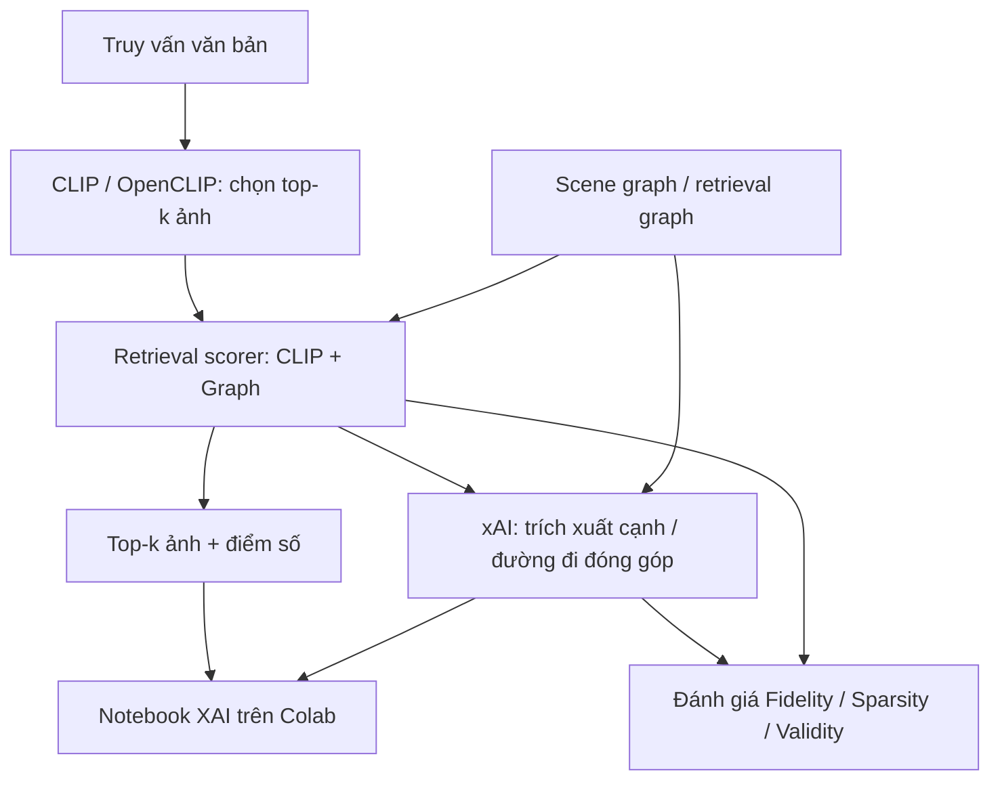

# Nhiệm vụ 3 — Explainability (xAI) cho Text-to-Image Retrieval

> **Bài toán:** Knowledge Graph–Enhanced Text-to-Image Retrieval
> **Mục đích tài liệu:** Mô tả phạm vi nhiệm vụ, kiến trúc tích hợp, tổ chức mã nguồn, đầu vào/đầu ra và tiêu chí nghiệm thu.
> **Kế hoạch chi tiết:** [`01_XAI_Explainability_Plan.md`](./01_XAI_Explainability_Plan.md).

## 1. Tổng quan nhiệm vụ

Mục tiêu là giải thích vì sao một ảnh được xếp hạng cao bằng **cạnh, đường đi hoặc đồ thị con thực sự ảnh hưởng đến graph score/final score**, sau đó đánh giá định lượng **fidelity, sparsity và validity**.

**Nguyên tắc xuyên suốt:** Không tạo lời giải thích chỉ vì đường đi nghe có vẻ hợp lý. Explanation phải xuất phát từ đúng đồ thị, scorer và cơ chế xếp hạng đang sử dụng; có thể kiểm chứng bằng can thiệp lên cạnh/đường đi và chạy lại mô hình.

### 1.1. Phạm vi tối thiểu

| Thành phần | Phạm vi cần thực hiện | Đầu ra chính |
|---|---|---|
| xAI extractor | Trích xuất các cạnh/đường đi có đóng góp cho từng `(query, image)` | Edge/path list, contribution, graph con |
| xAI evaluation | Fidelity, sparsity, structural validity, evidence support; baseline xóa cạnh ngẫu nhiên | Bảng metric và phân tích trường hợp |
| Truy vấn đánh giá | Tối thiểu 10 truy vấn phân tích định lượng; ưu tiên dùng bộ ≥20 truy vấn trực tiếp/gián tiếp của nhóm | `queries.csv`, case studies |
| Thí nghiệm Colab | Chạy checkpoint VG/PSG → giải thích → kiểm tra thay đổi score/rank | Notebook và CSV/JSON chạy lại được |

## 2. Kiến trúc tổng thể



Module xAI nhận graph, danh sách ảnh ứng viên và scorer; tạo explanation, can thiệp lên graph rồi đo ảnh hưởng đến score/rank. Điểm tích hợp với pipeline của nhóm là `image_id`, `query_id`, graph schema, scorer interface, split/seed và các bảng kết quả được thống nhất.

## 3. Cấu trúc hiện dùng

```text
duong/
├── xai/
│   ├── model.py            # QA scorer thật cho VG/PSG và graph can thiệp
│   ├── graph.py            # Node, Edge, schema, local graph
│   ├── scorer_adapter.py   # Giao diện score trên tập ứng viên cố định
│   ├── perturbation.py     # Xóa cạnh, chấm điểm lại, random baseline, rank
│   ├── explain.py          # Leave-one-edge-out và top-k cạnh
│   ├── evaluate_xai.py     # Fidelity, sparsity, validity
│   ├── io.py               # Xuất explanation
│   └── queries.csv         # Catalog truy vấn tham khảo, chưa dùng ở hai notebook
├── notebooks/
│   ├── train_vg_psg_for_xai_colab.ipynb
│   ├── xai_vg_psg_colab.ipynb
│   └── summarize_vg_psg_xai_colab.ipynb
├── runs/qa_vg_psg_xai/   # Snapshot checkpoint và XAI tải từ MyDrive, đã commit
│   ├── dual-*_manifest.json
│   ├── t1_qa_cn_no_sg_sage/   # 3 lượt huấn luyện VG
│   ├── psg_qa_cn/             # 3 lượt huấn luyện PSG
│   └── xai-*/                 # XAI thô và analysis/
└── tests/                  # Fixture nhỏ và test cho lõi XAI
```

Hai bundle nằm ngoài repo. Snapshot `runs/qa_vg_psg_xai/` đã được commit cùng mã nguồn để xem checkpoint và kết quả XAI; `.gitignore` vẫn bỏ qua các lượt `runs/` mới cho đến khi được thêm tường minh.

## 4. Các module cần thực hiện

### 4.1. Module xAI

- **`scorer_adapter.py`:** Thống nhất API tính `clip_score`, `graph_score`, `final_score` và kết nối scorer GNN thật.
- **`explain.py`:** Xác định đồ thị con ảnh hưởng tới dự đoán, đo đóng góp từng cạnh/đường đi và chọn explanation ngắn gọn.
- **`perturbation.py`:** Thực hiện xóa/mask cạnh explanation hoặc cạnh ngẫu nhiên; **tính lại graph-dependent score** trên graph sau can thiệp.
- **`evaluate_xai.py`:** Đo giảm score, đổi hạng, sparsity, validity và so sánh với random baseline.

Các metric cốt lõi:

| Metric | Ý nghĩa | Phép kiểm tra |
|---|---|---|
| Fidelity | Cạnh giải thích có ảnh hưởng thật đến dự đoán? | Xóa cạnh explanation, tính lại score/rank; đối chiếu xóa cạnh ngẫu nhiên cùng số lượng |
| Sparsity | Giải thích có cô đọng? | `1 - #explained_edges / #local_candidate_edges` |
| Structural validity | Quan hệ/đường đi có hợp lệ trong graph? | Kiểm tra edge IDs, node types, relation schema và tính liên thông |
| Evidence support | Giải thích có căn cứ từ dữ liệu nguồn? | Kiểm tra metadata/caption/triple provenance; rà soát mẫu |

Fidelity cần báo riêng biến động **graph score** và **final score**. Các so sánh thứ hạng phải sử dụng cùng candidate pool, cùng mô hình và cùng tham số.

## 5. Tích hợp với pipeline của nhóm

Các thành phần bên ngoài nhiệm vụ 3 được coi là **dependencies**, không phải phần cần triển khai lại:

| Đầu vào cần nhận | Nguồn từ nhóm | Yêu cầu tích hợp |
|---|---|---|
| CLIP features/scores, `candidate_image_ids`, split | Nhánh baseline retrieval | IDs cố định; score truy cập được cho mọi ứng viên |
| Graph schema, graph builder, GNN checkpoint/forward | Nhánh graph-enhanced retrieval | Có thể chạy lại forward khi thay đổi cạnh |
| Reranker tốt nhất, bộ truy vấn direct/indirect | Nhánh phương pháp mới | Cùng input/output và cùng evaluation protocol |

Đề xuất interface logic:

```python
# Pseudocode/API contract — các hàm sẽ được triển khai trong repo.
scores = scorer.score(query_text, candidate_image_ids, graph)
# scores[image_id] = {"clip_score": ..., "graph_score": ..., "final_score": ...}

explanation = explainer.explain(query_text, image_id, graph, scorer)
# explanation = {"edge_ids": [...], "paths": [...], "contributions": {...}}

metrics = evaluator.evaluate(
    query_text, image_id, candidate_image_ids, graph,
    scorer, explanation
)
# metrics = {"fidelity": ..., "sparsity": ..., "structural_validity": ...,
#            "evidence_support": ..., "rank_drop": ...}
```

Khi thành phần upstream chưa sẵn sàng, dùng graph/scorer mẫu **chỉ để phát triển và kiểm thử**. Thí nghiệm cuối phải dùng đúng scorer/model retrieval thực tế của nhóm.

## 6. Quy trình thực thi ở mức module

1. **Chuẩn hóa cấu hình và schema:** Thống nhất ID, node/relation types, score interface, dữ liệu/split và cơ chế lưu provenance.
2. **Xây xAI độc lập:** Dùng scorer mẫu để kiểm thử contribution, edge removal, random deletion, metric và biểu đồ.
3. **Tích hợp retrieval:** Kết nối adapter tới CLIP/GNN/reranker của nhóm, bảo đảm xóa cạnh dẫn tới chạy lại graph scoring.
4. **Đánh giá xAI:** Chạy trên tập truy vấn cố định, so sánh explanation vs random và phân tích 5 trường hợp thành công/5 thất bại.
5. **Đóng gói demo và tài liệu:** Xuất CSV, hình biểu đồ, notebook, hướng dẫn chạy và hạn chế của kết quả.

## 7. Tiêu chí nghiệm thu

- [ ] Có xAI extractor gắn với **cơ chế score thật**, không chỉ tạo đường đi hậu kiểm.
- [ ] Có fidelity, sparsity, validity và phép thử explanation-vs-random trên **ít nhất 10 truy vấn**.
- [ ] Có phân tích **5 retrieval success + 5 retrieval failure** và notebook xuất explanation có provenance.
- [ ] Có split/seed cố định, không dùng test để tuning hoặc tạo cạnh thống kê, và các thí nghiệm chính có thể chạy lại.
- [ ] Có hướng dẫn cài dependencies và các entry point chạy; không cần dựng web app hoàn chỉnh.

## 8. Ranh giới phạm vi và nguyên tắc thực hiện

- Không huấn luyện lại encoder thị giác lớn từ đầu; tận dụng mô hình của nhóm hoặc pretrained encoder.
- Không mở rộng nhiều phương pháp explainer/graph database nếu chưa hoàn thành pipeline định lượng tối thiểu.
- Không lấy nhãn relevance hoặc chọn hyperparameter từ chính tập test.
- Không nhầm **tính hợp lệ của cạnh** với **mức ảnh hưởng thực tế của cạnh lên quyết định xếp hạng**.
- Ưu tiên mã có thể kiểm thử, kết quả tái lập, nguồn dữ liệu minh bạch và demo ngắn gọn.

## 9. Lõi XAI hiện có

Các module `graph.py`, `scorer_adapter.py`, `perturbation.py`, `explain.py`, `evaluate_xai.py` và `io.py` được notebook XAI gọi trực tiếp hoặc gián tiếp. `model.py` chuyển graph can thiệp thành phép xóa cạnh thật trong QA scorer của Huy. Xóa cạnh quan hệ làm chạy lại `label_h`; xóa cạnh `contains` cập nhật nhãn ảnh, sau đó `graph_matrix` và phép fuse được tính lại trên đủ top-100 ứng viên. Cạnh ngoài tập sàng lọc vẫn giữ nguyên trong model.

Test lõi dùng fixture nhỏ trong `tests/`, không phải kết quả thực nghiệm:

```bash
cd duong
python -m unittest discover -s tests -v
```

Notebook chọn caption và ground truth từ `mmxai_eval.Protocol` của từng bundle. `xai/queries.csv` vẫn là catalog tham khảo, không được notebook hai bundle sử dụng. `EvidenceSupportRate` coi trạng thái `uncertain` là chưa được hỗ trợ; provenance của cạnh và hỗ trợ thị giác/ngữ nghĩa cần được phân biệt. Đóng góp leave-one-out không được cộng như một phân rã tuyến tính khi scorer phi tuyến.

## 10. Notebook Colab và kết quả đã chạy

Trên MyDrive, đặt `graphml-project3/`, `mmxai_vg_bundle/` và `mmxai_psg_bundle/` ở cùng cấp. Hai bundle đã có `huy_extra_cn`; không cần tải lại ConceptNet hoặc trích embedding nhãn. Chạy notebook theo thứ tự sau khi đồng bộ mã `duong/xai/` lên bản repo trên Drive:

| Notebook | Runtime | Công việc và đầu ra |
|---|---|---|
| [`train_vg_psg_for_xai_colab.ipynb`](notebooks/train_vg_psg_for_xai_colab.ipynb) | Colab GPU | Huấn luyện 3 seed/bộ. VG dùng SAGE + ConceptNet (`t1_qa_cn_no_sg_sage`); PSG dùng GAT + scene graph + ConceptNet (`psg_qa_cn`). Lưu `model.pt`, config, metric, ranks và manifest SHA256. |
| [`xai_vg_psg_colab.ipynb`](notebooks/xai_vg_psg_colab.ipynb) | Colab GPU | Kiểm tra bundle/checkpoint và tái hiện hạng gốc, rồi dùng `xai/model.py`, `EdgeContributionExplainer` và `XAIEvaluator` để xóa cạnh trên top-100 cố định. Chọn 12 caption/bộ, xét k=1/3/5 và 20 lượt xóa ngẫu nhiên khớp loại cạnh. |
| [`summarize_vg_psg_xai_colab.ipynb`](notebooks/summarize_vg_psg_xai_colab.ipynb) | Colab CPU | Đọc kết quả XAI, khôi phục model seed của lượt hiện tại, kiểm tra 216 dòng, xuất bảng theo seed/nhóm/k, bootstrap CI theo caption, hình và `report.md`. Không chạy lại model. |

### Thư mục `runs/qa_vg_psg_xai`

Lượt hiện có dùng manifest [`dual-20261121-125423_manifest.json`](runs/qa_vg_psg_xai/dual-20261121-125423_manifest.json) và kết quả XAI `xai-20261121-130842/`:

| Đường dẫn | Nội dung |
|---|---|
| `t1_qa_cn_no_sg_sage/dual-20261121-125423_vg_seed{0,1,2}/` | Ba checkpoint VG; mỗi thư mục có `model.pt`, `config.json`, `train_info.json`, `metrics.json`, `protocol_result.json`, `ranks_test_full.json`. |
| `psg_qa_cn/dual-20261121-125423_psg_seed{0,1,2}/` | Ba checkpoint PSG cùng bộ file. |
| `xai-20261121-130842/xai_results.csv` | 216 dòng XAI thô: 2 bộ × 12 caption × 3 model seed × 3 mức k. |
| `xai-20261121-130842/selected_cases.json`, `explanations.json`, `summary.json` | Case đã chọn, cạnh/đường đi giải thích và 24 nhóm số liệu tổng hợp. |
| [`xai-20261121-130842/analysis/`](runs/qa_vg_psg_xai/xai-20261121-130842/analysis/) | CSV đã sửa seed, sáu JSON theo model seed, bảng theo nhóm/seed, hai hình, bootstrap CI, `case_studies_10.csv`, 15 ảnh minh họa trong `case_images/` và [`report.md`](runs/qa_vg_psg_xai/xai-20261121-130842/analysis/report.md). |

**Đọc kết quả của lượt này:** cột `seed` trong CSV thô chứa seed của random baseline, nên sáu file `xai-20261121-130842/{vg,psg}_seed{0,1,2}.json` rỗng. Dùng `analysis/xai_results_corrected.csv` hoặc `analysis/*_seed*_corrected.json` khi phân tích theo **model seed**. `summary.json` thô vẫn tổng hợp đủ 216 dòng; notebook tổng hợp giữ nguyên dữ liệu thô và ghi bản sửa riêng trong `analysis/`. Mã notebook XAI đã sửa cách ghi seed cho lượt chạy sau.

Xem [`analysis/report.md`](runs/qa_vg_psg_xai/xai-20261121-130842/analysis/report.md) để đọc đầy đủ metric và giới hạn. Ở k=3, mức giảm điểm fuse trung bình của cạnh giải thích so với cạnh ngẫu nhiên là **0,902 so với 0,173** trên VG và **1,723 so với 0,726** trên PSG. Đây là điểm fuse đã chuẩn hóa, không phải mức tăng MRR. Mỗi bộ chỉ có 12 caption được chọn theo kết quả seed 0; coverage vùng cạnh 2-hop được xét dưới 1%. Hai cấu hình dùng GNN và tập cạnh khác nhau nên không quy chênh lệch giữa hai bộ riêng cho dataset.

Sau khi clone commit chứa snapshot, các bảng/checkpoint/ảnh của lượt này đã có sẵn trong `duong/runs/`. Manifest vẫn ghi đường dẫn tuyệt đối `/content/drive/MyDrive/...`; muốn chạy lại notebook ở máy local cần đổi đường dẫn và có hai bundle VG/PSG bên ngoài `runs/`. Chạy lại cell cuối của notebook tổng hợp sẽ tạo lại bản `report.md` ngắn và ghi đè phần diễn giải đã bổ sung thủ công.
