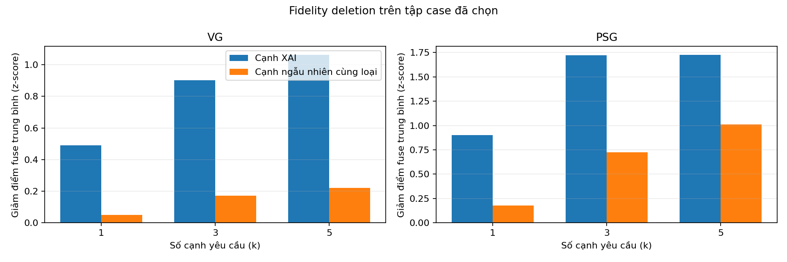
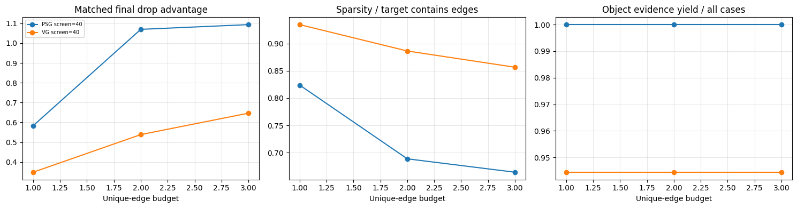

# Giải thích truy hồi văn bản–ảnh bằng cạnh đối tượng: đánh giá thực nghiệm trên VG và PSG

## Tóm tắt

Nghiên cứu đánh giá liệu các cạnh trong đồ thị được chọn để giải thích một ảnh đứng đầu có thực sự ảnh hưởng đến điểm truy hồi, và liệu ảnh đó có phù hợp với truy vấn hay không. Hai lượt thực nghiệm trên cấu hình Visual Genome (VG) và Panoptic Scene Graph (PSG) cho thấy **xóa các cạnh giải thích làm giảm điểm của ảnh đang được giải thích nhiều hơn xóa cạnh đối chứng**. Ở lượt tập trung vào truy vấn trực tiếp, tỷ lệ tìm được ít nhất một cạnh đối tượng có đóng góp dương là **94,4% trên VG** và **100% trên PSG**. Tuy nhiên, độ trung thực đối với hàm chấm điểm không tự chứng minh rằng cạnh diễn đạt đúng toàn bộ nội dung ảnh. Trong 10 trường hợp được xem ảnh, cả 5 ảnh đứng đầu khác ID ảnh chuẩn vẫn được người đánh giá xác nhận là phù hợp với truy vấn. Vì vậy, báo cáo tách rõ *khớp ID ảnh chuẩn*, *phù hợp ngữ nghĩa* và *tác động nhân quả lên điểm mô hình*.

## Thiết kế và phép đo

Lượt khảo sát ban đầu gồm **24 câu mô tả ảnh** (12 cho mỗi bộ VG, PSG), đánh giá trên **ba phiên bản mô hình** và ngân sách xóa **1, 3 hoặc 5 cạnh**. Mỗi quan sát xóa các cạnh do bộ giải thích chọn, rồi chấm lại cùng tập 100 ảnh ứng viên; đối chứng xóa ngẫu nhiên cùng số cạnh và loại cạnh, lặp 20 lần. Tập câu mô tả được chọn có chủ đích theo hạng của ảnh chuẩn ở một phiên bản mô hình, nên đây là mẫu phân tích, không phải mẫu ngẫu nhiên của toàn bộ tập kiểm thử.

Lượt chính tập trung vào **34 truy vấn trực tiếp đã được duyệt** (18 VG, 16 PSG), với ảnh chuẩn được xác nhận hỗ trợ truy vấn. Mỗi truy vấn được đánh giá trên ba phiên bản mô hình, tạo **54 trường hợp VG** và **48 trường hợp PSG** ở mỗi ngân sách **1, 2 hoặc 3 cạnh duy nhất**. Cạnh giải thích là cạnh nối nhãn đối tượng phù hợp với truy vấn tới ảnh đứng đầu. Sau khi xóa cạnh, hệ thống chấm lại 100 ảnh ứng viên cố định. Đối chứng là các cạnh đối tượng *khác* của cùng ảnh, với ngân sách xóa tương ứng; trường hợp không có đối chứng độc lập được ghi là không áp dụng.

Trong cả hai lượt, **mức giảm điểm** là điểm hợp nhất của ảnh đứng đầu trước trừ sau can thiệp; **lợi thế fidelity** là mức giảm điểm khi xóa cạnh giải thích trừ mức giảm trung bình khi xóa cạnh đối chứng. Điểm này ở thang chuẩn hóa của mô hình, không phải tỷ lệ phần trăm, xác suất đúng hay thay đổi chất lượng truy hồi toàn tập. **Độ bao phủ đối tượng** ở lượt chính là tỷ lệ *mọi trường hợp đã đăng ký* có ít nhất một cạnh phù hợp với truy vấn và có đóng góp dương. **Độ thưa của giải thích (sparsity)** là một trừ tỷ lệ cạnh giải thích trên số cạnh đối tượng đủ điều kiện của ảnh đích; chỉ tính khi có giải thích. Khoảng tin cậy 95% được bootstrap theo truy vấn, giữ ba phiên bản mô hình trong cùng cụm.

## Kết quả

### 1. Khảo sát ban đầu: cạnh giải thích ảnh hưởng đến điểm mô hình

*Hình 1.* Mức giảm trung bình của điểm ảnh đứng đầu trên mẫu caption ban đầu. Mỗi cột tổng hợp 12 câu mô tả × 3 phiên bản mô hình trong từng bộ dữ liệu. Hai bộ dữ liệu có cấu hình đồ thị và mô hình khác nhau; độ cao cột chỉ nên so sánh **trong cùng bộ dữ liệu**.

Ở ngân sách ba cạnh, mức giảm điểm khi xóa cạnh giải thích so với đối chứng lần lượt là **0,902 so với 0,173 trên VG** và **1,723 so với 0,726 trên PSG**. Lợi thế tương ứng là **0,729** (khoảng tin cậy 95%: **0,561–0,931**) và **0,996** (**0,878–1,104**). Trên cả ba phiên bản mô hình, lợi thế trung bình tại ngân sách này đều dương. Tuy vậy, ảnh chuẩn chỉ tăng hạng trong **7/36** trường hợp VG và **18/36** trường hợp PSG: làm yếu đi ảnh đang đứng đầu không bảo đảm ảnh chuẩn được đưa lên cao hơn.

Giải thích ban đầu chủ yếu dùng cạnh đối tượng nối tới ảnh: tại ngân sách ba cạnh, **102/108 cạnh VG** và **104/108 cạnh PSG** thuộc loại này. Các đường đi hợp lệ về cấu trúc đồ thị, nhưng ở lượt khảo sát này chưa có đánh giá độc lập chứng minh từng cạnh đúng với nội dung ảnh. Vì thế, kết quả ban đầu ủng hộ nhận định về **sự phụ thuộc của điểm mô hình vào cạnh**, chưa ủng hộ diễn giải quan hệ nhiều bước.

### 2. Truy vấn trực tiếp: độ bao phủ và fidelity có điều kiện

| Bộ dữ liệu | Ngân sách cạnh | Có giải thích / tất cả trường hợp | Có đối chứng / tất cả trường hợp | Lợi thế fidelity trung bình (KTC 95%) | Sparsity trung bình |
|:--|--:|--:|--:|:--|--:|
| VG | 1 | 51/54 | 51/54 | 0,348 (0,264–0,436) | 93,5% |
| VG | 2 | 51/54 | 51/54 | 0,538 (0,404–0,667) | 88,7% |
| VG | 3 | 51/54 | 51/54 | 0,646 (0,481–0,818) | 85,7% |
| PSG | 1 | 48/48 | 48/48 | 0,583 (0,500–0,660) | 82,4% |
| PSG | 2 | 48/48 | 48/48 | 1,070 (0,818–1,342) | 68,9% |
| PSG | 3 | 48/48 | 45/48 | 1,094 (0,831–1,388) | 66,4% |

*Bảng 1.* “Có giải thích” luôn tính trên toàn bộ trường hợp. Fidelity chỉ tính nơi có tập cạnh đối chứng độc lập; ở ngân sách ba cạnh của PSG, ba trường hợp thiếu đối chứng không bị gán giá trị 0. Sparsity chỉ tính khi tồn tại giải thích. Khoảng tin cậy dựa trên **17 truy vấn VG** có đối chứng ở mỗi ngân sách, và **16, 16, 15 truy vấn PSG** ở ngân sách 1, 2, 3.

*Hình 2.* Ba phép đo của lượt truy vấn trực tiếp, với giới hạn xét tối đa 40 ứng viên đường cạnh cho mỗi trường hợp. Đường fidelity là mức giảm điểm có điều kiện trên các trường hợp có đối chứng; đường bao phủ tính cả trường hợp không có đường đối tượng. Sparsity giảm khi cho phép chọn thêm cạnh vì giải thích chiếm phần lớn hơn trong tập cạnh đối tượng đủ điều kiện. Không so độ lớn điểm giữa VG và PSG như một phép so sánh chất lượng hai bộ dữ liệu.

VG có **ba trường hợp không tìm thấy cạnh đối tượng** (cùng một truy vấn trên ba phiên bản mô hình), được giữ trong mẫu số độ bao phủ. Trong các trường hợp còn lại, lợi thế fidelity trung bình dương ở mọi ngân sách. Điều này cho thấy các cạnh được chọn có tác động lớn hơn những cạnh đối chứng cùng ảnh. Vì thuật toán **chọn cạnh dựa trên chính mức giảm điểm**, lợi thế so với cạnh ngẫu nhiên có thể tăng do cơ chế chọn; đây là thống kê mô tả về độ trung thực với mô hình (fidelity) có điều kiện, không phải một kiểm định độc lập chứng minh cạnh đúng về ngữ nghĩa.

### 3. Khớp ID ảnh chuẩn khác với mức phù hợp truy vấn

Trên 34 truy vấn trực tiếp và ba phiên bản mô hình, ảnh đứng đầu trùng **ID ảnh chuẩn** trong **35/54 trường hợp VG** và **27/48 trường hợp PSG**. Đây là chỉ số của benchmark gắn một ảnh chuẩn cho mỗi truy vấn; một ảnh khác ID vẫn có thể mô tả đúng câu truy vấn.

Mười trường hợp có ảnh được chọn cân bằng trước theo kết quả ID: **5 trùng ID và 5 khác ID**. Năm ảnh trùng ID đã được xác nhận hỗ trợ truy vấn; người đánh giá cũng xác nhận bằng mắt rằng **cả 5 ảnh khác ID đều hỗ trợ truy vấn**. Như vậy, **10/10 ảnh được xem là phù hợp** trong *mẫu minh họa được chọn*, dù chỉ **5/10 trùng ID ảnh chuẩn**. Con số 10/10 không phải ước lượng độ chính xác ngữ nghĩa trên toàn bộ 34 truy vấn vì mẫu đã được phân tầng theo ID và chỉ có một lượt xác nhận trực quan cho các ảnh lệch ID.

## Diễn giải và giới hạn

Kết quả nhất quán với vai trò của cạnh đối tượng trong quyết định truy hồi: xóa một số ít cạnh có thể làm điểm của ảnh đứng đầu giảm rõ rệt. Kết luận này chỉ áp dụng cho **hàm chấm điểm, tập ảnh ứng viên và thiết lập can thiệp đã kiểm tra**. Nó không chứng minh mô hình hiểu quan hệ trong câu, cũng không xác nhận từng nhãn đối tượng hoặc toàn bộ caption bằng thị giác. Mô hình đã huấn luyện không mã hóa danh tính nhãn quan hệ (predicate) trong đặc trưng cạnh, nên các phát biểu về hành động, vị trí hay quan hệ giữa đối tượng nằm ngoài phạm vi thí nghiệm.

Các giới hạn chính gồm: (i) hai lượt có tập truy vấn và đối chứng khác nhau, nên không diễn giải chênh lệch số điểm giữa hai lượt như mức cải thiện của phương pháp; (ii) ba phiên bản mô hình dùng lại cùng truy vấn, đã được xử lý theo cụm khi tính khoảng tin cậy nhưng vẫn là mẫu nhỏ được chọn có chủ đích; (iii) phần kiểm tra ảnh chỉ gồm 10 trường hợp, không có chấm độc lập trên toàn bộ tập và chưa định lượng độ đúng thị giác của từng cạnh giải thích; (iv) đánh giá xóa cạnh giữ cố định 100 ảnh ứng viên, nên không phản ánh mọi thay đổi có thể xảy ra khi truy hồi lại trên toàn bộ kho ảnh; và (v) các thang điểm VG và PSG thuộc hai cấu hình khác nhau, không dùng để xếp hạng trực tiếp hai bộ dữ liệu.

**Kết luận:** Thí nghiệm cung cấp bằng chứng về **fidelity của giải thích cạnh đối tượng đối với quyết định của mô hình** trên tập truy vấn trực tiếp đã duyệt. Việc xác minh ảnh cho thấy lỗi khớp ID có thể phóng đại lỗi truy hồi ngữ nghĩa; đánh giá tiếp theo cần chấm mức phù hợp của mọi ảnh trả về và căn cứ thị giác của từng cạnh trên một mẫu đại diện hơn.
